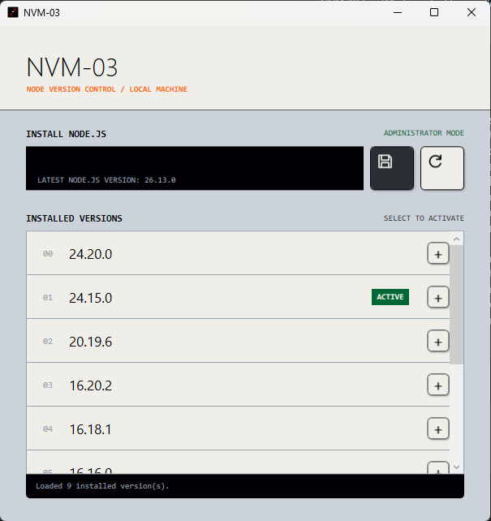

# NVM-03

NVM-03 is a Windows desktop application for managing Node.js versions with NVM for Windows. It lists installed versions, lets you install and activate versions, and supports custom tags for each version. It also displays the latest available Node.js version when online.



## Requirements

- Windows x64
- [NVM for Windows](https://github.com/coreybutler/nvm-windows) installed and available on `PATH`
- .NET 8 SDK to build the application
- Administrator privileges to run the application

Verify that NVM is available by running `nvm version` in a terminal.

## Build and run

From the project directory, publish a self-contained executable:

```powershell
dotnet publish NvmSwitcher.csproj -c Release -o publish-single
```

Run `publish-single\NVM-03.exe` and approve the administrator prompt. The published application does not require a separate .NET runtime installation, but NVM for Windows must still be installed.

To build without publishing, run:

```powershell
dotnet build NvmSwitcher.csproj
```

## Usage

Enter a Node.js version and select the install button. Select an installed version to activate it, use the refresh button to reload the list, or use the `+` button to edit a version's tags. Tags are stored locally in `%APPDATA%\NVM-03\tags.json`.
